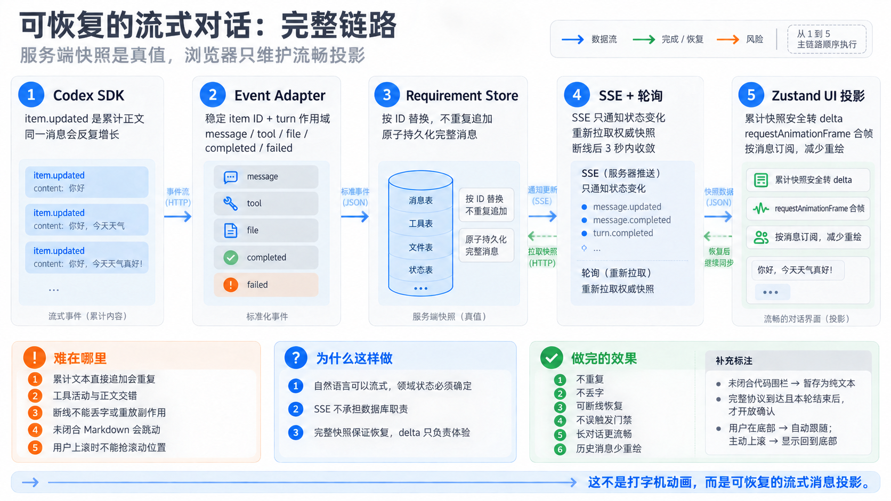

# 智能产品研发工作台：STAR 面试讲稿

## 用一句话介绍智能产品研发工作台

别名：一句话介绍智能产品研发工作台、工作台一句话介绍、研发工作台一句话概括

我把自己使用 AI 做研发的流程做成了一个本地智能产品研发工作台。产品直接说明页面和预期结果，Agent 负责需求对齐、生成 Spec、拆 Ticket 和形成候选代码；工作台负责 Git 隔离、项目运行和验证，前端保留最终的代码审查与生产合并权。

## 为什么要建设智能产品研发工作台？

别名：为什么做智能产品研发工作台、工作台项目背景、研发工作台建设背景、这个工作台解决了什么问题

这个平台不是从功能清单出发设计的。它来自我长期使用 AI 开发后形成的一套工作方式。

第一条规则是，在事情有结论之前不允许修改代码。AI 很容易拿到一句提示就直接开工，而且通常不会主动说明自己缺了哪些背景。我要求它先查事实，再把真正影响实现的决策拿出来问我。它要说明为什么问、有哪些方案，我负责补充业务背景和做决定。

第二条规则是把项目上下文写下来。我接手项目时本来就会整理目录结构、启动方式、技术栈、公共组件和历史问题。现在这些资料也会提供给 AI。每次都重要、但 AI 无法猜到的规则放在 `AGENTS.md`；更细的用法放进 docs 或 Skill，需要时再读。这样既能给足上下文，也不会把入口文档写成百科全书。

第三条规则是保留正常研发流程。需求先对齐，再做技术拆解，然后切成能独立实现和验证的小任务。代码完成后要跑类型检查、Lint、测试和构建，再从需求与工程规范两个方向做独立 Review。涉及 UI 时还要打开真实页面，检查交互、布局、长文本、可访问性和控制台错误。

最后，重复出现的做法要沉淀。组件库规范、接口类型生成、Code Review 和 UI 验收都可以做成 Skill 或 checklist。我的顺序一直是先手动跑通，确认稳定后再固化，最后才考虑自动化。智能产品研发工作台就是这套个人方法的产品化版本。

## 智能产品研发工作台 STAR

别名：讲一下工作台这个项目、介绍一下工作台这个项目、完整介绍智能产品研发工作台、详细讲讲研发工作台项目、智能产品研发工作台项目经历

### Situation

产品提出页面需求后，通常要先写文档或原型，再和前端需求评审。前端对齐需求、补产出技术方案，然后开始开发。现在不少实现工作本身也会交给 Agent，于是前端还要再和agent复述一遍需求。

在实际使用 AI 开发的过程中，我已经形成了一套固定做法：先补项目上下文，让 AI 查已有的代码事实；再把业务需求问清楚；实现拆成小任务；最后用agent检查、独立 Review 和真实页面验收。我想做的，是把这套依赖个人经验的流程变成产品能力，同时减少产品需求被前端再次翻译给 Agent 的成本。

### Task

我把目标定成了一个本地工作台：产品可以直接和 Agent 对齐需求，但 Agent 不能收到一句话就开始改代码。系统要先得到明确的结果、方案和对齐信号，再生成 Spec 和 Ticket。确认完成后，Agent 才能进入真实前端仓库。

我还给这个流程划了明确的权限：

- 产品决定需求意图，并负责页面是否符合预期。
- Agent 负责生成候选实现，不能自行宣布验收通过。
- 工作台管理状态、Git、项目进程和验证证据。
- 前端决定候选代码是否保留、重构或合并。

### Action

产品创建需求时先描述需求的具体内容。这里不用输入启动命令、仓库路径或具体代码方案。接下来进入只读的 Grilling 对话，Agent 根据当前信息继续追问，最后形成四项结构化结果：共同理解、目标结果、修改边界和验收信号。

服务端不会因为对话里出现“已经确认”几个字就推进流程。Agent 必须返回合法的结构化协议，产品也必须点击确认，状态机才会进入 Spec 阶段。

Spec 由独立的 `to-spec` 流程生成，并保存为有版本的本地文件。产品调整共同理解后，依赖旧信息的 Spec 会失效；新草稿产生时，旧版本保留为 `superseded`，不会被覆盖。产品只能确认当前版本。确认后再进入 `to-tickets`，Ticket 按用户能观察到的结果拆分，执行时始终只有一张处于 active。

这些工作流 Skill 都随仓库保存在 `.agents/skills/`。工作台先验证 Skill 文件存在，再把准确路径交给 Codex 读取。目标项目自己的 Skill 则从业务仓库发现，只有被产品点名、被规则要求或命中明确需求类型时才激活。工作流阶段和项目 Skill 是两个领域概念，页面和执行上下文不会把它们混在一起。

进入实现前，工作台检查目标仓库当前分支、HEAD、working tree，以及是否处于 merge 或 rebase。工作区不干净就停止，不自动 stash，也不 reset。检查通过后，系统从记录的 base revision 创建独立的 `product/<spec-id>-<slug>` 分支。

实现默认通过项目固定版本的 Codex app-server 运行，旧 SDK 只保留为显式回退。规划 Thread 使用 read-only，实际编码使用 workspace-write，并把工作目录收窄到产品已经确认的范围。每个 turn 前后，工作台都会重新检查分支、HEAD、已跟踪文件和未跟踪文件。发现越界修改后立即阻塞，不继续下一张 Ticket。产品取消执行时，只中止工作台持有的当前 turn，分支、Requirement 和 Thread ID 都会保留，后面可以接着做。

代码完成后，验证不依赖 Agent 的文字结论。工作台宿主按目标项目配置运行 typecheck、测试和 build，记录命令、退出码、起止时间和脱敏日志。Target Runtime 单独管理开发服务、健康检查和进程组回收。页面验证通过 `agent-browser` 访问真实路由，保存 viewport、Accessibility Tree、语义引用和新增的 console error；行为稳定后再用 Playwright 固化回归。

每条验收条件都有对应的验证记录，结果只能是 `verified`、`failed` 或 `not-run`。`not-run` 必须说明原因。必要机器检查失败或没有运行时，服务端不会开放产品验收入口。

如果预览结果还需要调整，产品可以在同一个 Requirement 中继续返修。系统会追加一张 Ticket，沿用原来的 Spec 身份、需求分支、确认范围和实现 Thread，同时保留上一轮验证结果。只有成功完成的返修才增加修改轮次。

产品验收后，工作台会再检查一次分支和文件范围，然后把最终 Spec、Tickets、验证矩阵、风险说明和 Frontend Delivery Handoff 与业务代码放进同一个候选提交。系统到这里就停下，不 push、不建 PR，也不 merge。

### Result

我用真实的 `Mysterious-Realm-v2 / front` 跑过一次完整需求。系统创建了独立 Spec 分支，使用同一个实现 Thread 完成候选修改，最终生成稳定提交 `28f965aef3d416afa8e928bf5c8d050bee2a9125`。

这次验收一共留下 12 项 `verified` 记录。真实页面检查保存了 68 个语义引用，没有新增 console error 或 page error。工作台自身当时通过了 typecheck、production build、39 项 Vitest 和 1 项 Playwright E2E。

交付物里能查到产品确认的需求、Agent 使用的规则和 Skill、修改文件、验证结果、没做的检查以及最终责任人。前端拿到的不是一段聊天记录，而是一份可以继续审查的候选实现。

## 用三分钟介绍智能产品研发工作台

别名：三分钟介绍智能产品研发工作台、工作台三分钟介绍、研发工作台口语版，简单介绍一下工作台

这个项目叫智能产品研发工作台。它其实是我自己使用 AI 做研发的方式，慢慢产品化之后的结果。

我的原则是：事实让 AI 查，决策由人确认，结果必须验证。在事情有结论之前，我不允许 AI 修改代码。代码、路由和配置让它自己查，业务边界和技术取舍必须拿出来问。项目结构、组件规范和检查方式放在 `AGENTS.md`、docs 或 Skill，单次需求的决定写进 Spec、Tickets 和 Handoff，不能只留在聊天记录里。

有了这套方法以后，我注意到产品需求进入开发时还有一次重复沟通：产品先向前端解释，前端理解后，又要把需求整理成 Prompt 交给 Agent。于是我做了这个工作台，让产品可以直接说明页面和预期结果，但研发门禁仍然保留。

产品创建需求后，先进入只读的 Grilling 对话。Agent 会确认用户最终应该看到什么、哪些地方不能改，以及验收的标准。事实问题由它读取仓库解决，需要人判断的地方再来问。结果保存成结构化的共同理解，产品确认后才允许生成 Spec。

Spec 有版本，不会直接覆盖旧草稿。确认后再拆成 Ticket，每张 Ticket 对应一个用户能观察到的结果。到这里仍然没有改业务代码。

执行前，工作台检查真实仓库的分支、HEAD、未提交修改，以及是否正在 merge 或 rebase。通过后，从固定 revision 创建独立 Spec 分支。规划 Thread 只读，实现 Thread 只能写确认过的目录；每轮前后再检查 Git，越界就停止。

验证和写代码是分开的。Codex 负责候选实现，工作台宿主运行 typecheck、测试和 build，`agent-browser` 打开真实路由，保存 viewport、Accessibility Tree 和控制台错误。每条验收条件只有 `verified`、`failed` 和 `not-run` 三种结果。没有证据，就不能写成通过。

产品不满意时，可以在同一个 Requirement 里继续返修，沿用原分支和实现 Thread。验收后，Spec、Tickets、验证矩阵、风险和 Handoff 会和代码一起进入候选提交。系统不自动 push 或 merge，前端仍然决定代码是否进入生产。

我最后在真实前端仓库跑通了一次需求。最终有 12 项验证通过，浏览器检查保存了 68 个语义引用，没有新增控制台错误。对我来说，这个平台真正解决的是两件事：减少产品、前端和 Agent 之间的重复转述，也把我原来靠个人习惯执行的 AI 研发流程，变成了一套其他人也能按相同标准使用的工具。


## 智能产品研发工作台最难的地方是什么？

别名：工作台最难的地方、研发工作台最大难点、智能产品研发工作台技术挑战、这个工作台最有挑战的地方

最难的不是调用 Codex，而是把不稳定的自然语言执行放进一套稳定的研发流程。

## 智能产品研发工作台如何用确定性门禁约束 Agent？

别名：工作台如何约束 Agent、Agent 为什么不能直接改代码、概率性输出如何接入确定性流程、研发工作台状态门禁

Agent 可能漏字段、误解需求，也可能只是在回复里说了一句“已经完成”。系统不能因为这句话就生成 Spec、创建分支或开放验收。

我给 Grilling、Spec、Tickets、Implement 和 Verification 分别设置了服务端门禁。Agent 需要返回合法的结构化协议，产品还要确认当前版本。状态、版本和验证结果都满足条件后，流程才会推进。自然语言负责沟通，结构化状态负责授权。

## 智能产品研发工作台如何保证状态一致性和故障恢复？

别名：工作台状态一致性、研发工作台服务重启恢复、Requirement 如何持久化、Ticket 中断后如何继续、重复请求如何保证幂等

Requirement、Spec 和 Ticket 要跨刷新、跨服务重启保存；Codex turn、SSE 连接和开发服务却是内存里的运行实例。用户双击按钮或浏览器重试时，还可能重复创建分支、启动进程或提交代码。

Requirement 因此被设计成聚合根，更新操作进入串行队列，再通过临时文件和 `rename` 原子写入。所有副作用请求都有幂等键。Codex 执行期间还会写心跳；服务重启后，如果磁盘仍是 `running`，但进程和心跳已经消失，系统会恢复为可重试状态，并保留原来的分支和 Thread ID。

## 智能产品研发工作台如何安全地让 Agent 修改真实仓库？

别名：Agent 修改仓库如何防止越界、工作台如何限制代码修改范围、研发工作台 Git 安全、为什么不自动 stash 和 reset

Prompt 里的“不要越界”不是安全措施，只能算提醒。工作台执行前记录当前分支、HEAD、base revision 和 working tree。发现未提交修改或 merge/rebase 就停止，不自动 stash，也不 reset。

检查通过后，系统从固定 revision 创建需求分支，把 Codex 的工作目录收窄到确认范围。每个 turn 前后继续核对分支、HEAD、tracked 和 untracked 文件；越界就阻塞队列。产品验收前再检查一次，只暂存允许目录中的文件。

这是一套纵深检查。任何单层判断都可能失效，所以权限、状态机和 Git 事实要一起使用。

## 智能产品研发工作台如何区分代码失败和环境失败？

别名：环境问题为什么不能算代码失败、工作台验证环境隔离、Codex 沙箱不能启动服务怎么办、failed 和 not-run 有什么区别

真实项目里遇到过一次很典型的问题：Agent 只改了一行文案，类型检查通过，但它所在的沙箱不能监听端口，也不能访问宿主代理，导致开发服务和字体构建失败。候选代码没有错，失败的是验证环境。

我把职责拆开：Codex 负责候选代码；工作台宿主运行类型检查、测试和构建；Target Runtime 管理开发服务；`agent-browser` 检查真实页面；产品确认页面语义；前端决定是否进入生产。

验证结果只能是 `verified`、`failed` 或带原因的 `not-run`。没有运行就明确写没有运行，环境问题也不会被伪装成代码失败。

## 智能产品研发工作台如何实现可恢复的流式对话？

别名：工作台流式对话、研发工作台 SSE 断线恢复、文字 delta 如何持久化、sequence 和 revision 有什么作用、流式 Markdown 怎么处理



旧 SDK 的 `runStreamed()` 能返回生命周期事件，但 assistant 正文通常在 `item.completed` 一次给全。当前版本已经把默认后端换成 Codex app-server，直接消费 `item/agentMessage/delta`。因此页面展示的是上游真实文字增量，但粒度可能是一个字，也可能是一整段，不承诺逐 token。

链路分成快路和稳路：

```text
app-server 文字 delta
  → Adapter 按 item 累计正文并建立 Turn 作用域 ID
  → 50ms / 4KB 合成带连续序号的 SSE batch
  → React Query 投影当前消息

同一批 delta
  → 500ms / 32KB 保存累计全文
  → Requirement 权威快照
  → item.completed 用同 ID 的最终全文校准
```

SSE batch 带 `sequenceStart`、`sequenceEnd` 和 revision。浏览器忽略重复批次；发现序号缺口时不猜内容，直接重新获取 Requirement 快照。较慢的 HTTP 响应也不能用旧 revision 覆盖已经投影的新数据。连接正常时保留 30 秒低频校准，断线后切到三秒轮询；EventSource 重连成功时先 refetch，再继续消费实时批次。

服务端持久化必须串行。500ms 定时写入可能仍在进行，如果 completed 到达后直接保存最终全文，较慢的旧写入可能反过来覆盖终态。因此工具事件、文件事件和终态之前都先 flush 文字缓冲，再用同 item ID 的 completed 全文替换累计内容。

流式 Markdown 还有一个特殊问题：代码围栏尚未闭合时，Markdown 解析器可能反复把后续文本从段落改成代码块，造成布局跳动和高亮开销。当前实现把未闭合的代码围栏暂时作为纯文本 `<pre>` 展示，围栏闭合后再交给 Markdown 解析器。Spec 的结构化控制块在流式期间不会展示半截 JSON；Grilling 也只有在完整 understanding 和 READY 标记同时到达、随后收到 turn completed 后，才会打开确认门禁。

面试时可以把这一点概括为：

> 我把 app-server 的文字 delta 分成快路和稳路：快路合批后通过 SSE 投影到 React Query，稳路定期把累计全文写入 Requirement。sequence 负责发现重复和缺口，revision 防止慢快照倒退，completed 全文负责最终校准。页面显示快，但正确性始终由服务端快照保证。

## 智能产品研发工作台如何预览真实前端应用？

别名：工作台如何嵌入真实页面、iframe 被 CSP 阻止怎么办、研发工作台如何代理 HMR WebSocket、预览网关如何保证安全

目标页面不是一张截图，而是正在运行的 Vite 或 Next 应用。普通 HTTP 代理只能显示首屏，HMR 使用的 WebSocket 会断开；直接放进 iframe 又可能被 `X-Frame-Options` 或 CSP `frame-ancestors` 拒绝。

预览网关因此同时代理 HTTP 和 WebSocket，并且只删除开发期嵌入所需的两类响应头，Cookie、其他 CSP 和业务响应保持原样。所有请求都被锁定到已配置的 loopback upstream，`//evil.example` 这类 protocol-relative 地址会被拒绝，避免预览网关变成开放代理。

## 智能产品研发工作台有哪些核心能力？

别名：工作台能做什么、研发工作台核心功能、智能产品研发工作台功能介绍、平台自动帮产品完成了什么

核心能力分为需求对齐与规划、目标项目运行与预览、代码执行与恢复、验证与交付四部分，同时明确保留不自动发布的责任边界。

## 智能产品研发工作台如何完成需求对齐和规划？

别名：工作台如何对齐需求、产品如何直接和 Agent 对齐、需求如何生成 Spec 和 Ticket、Grilling 流程怎么做

- 创建并持久化唯一活动 Requirement，页面刷新后可以继续。
- 启动只读 Grilling Thread，围绕目标结果、修改边界和验收信号继续追问。
- 校验结构化共同理解，未确认时不允许生成 Spec 或修改代码。
- 生成版本化 Spec；修改共同理解后自动废弃依赖旧信息的草稿，但保留历史版本。
- 将确认后的 Spec 拆成串行 Tickets，并识别鉴权、数据库、共享契约、公共组件、跨应用和发布等高风险边界。
- 只读扫描候选代码位置、根 `AGENTS.md`、最近目录规则和目标项目 Skills，记录各项为何生效。

## 智能产品研发工作台如何管理目标项目运行和预览？

别名：工作台如何启动目标项目、Target Runtime 怎么管理、开发服务如何做健康检查、本地预览网关怎么做

- 从受信配置读取仓库根目录、允许修改范围、启动命令、健康地址和预览地址，并检查路径不能逃出仓库、URL 只能指向本机。
- 产品点击启动后，工作台在目标仓库运行配置好的开发命令，显示命令、PID、健康状态、预览地址和最近输出。
- 轮询健康地址，区分“启动成功”“启动进程提前退出”和“等待超时”。失败后可以直接重试。
- 启动前检查目标端口。如果健康响应包含项目专属标记，可以安全复用用户已启动的服务；身份不明的进程只会被报告，不会被终止。
- 停止时只回收工作台拥有的整个进程组，先尝试 `SIGTERM`，超时后再强制结束，不扫描或误杀用户进程。
- 自动启动 localhost 预览网关，将真实目标页面嵌入工作台。网关只移除阻止 iframe 的 `X-Frame-Options` 和 CSP `frame-ancestors`，其他安全头保持原样。
- 代理 WebSocket，使 Vite 或 Next 的 HMR 在嵌入预览里仍然工作；产品也可以刷新 iframe 或在外部浏览器打开真实地址。
- Codex 执行可能触发 build 时，工作台会暂停自己拥有的 dev server，避免多个进程争用 `.next`，结束后再恢复预览。

## 智能产品研发工作台如何执行代码并恢复中断任务？

别名：工作台代码执行流程、Codex Thread 如何恢复、Ticket 队列如何执行、任务失败或取消后怎么继续

- 检查 working tree 和 Git 操作状态，从精确 base revision 创建独立需求分支。
- 使用 Codex app-server 创建或恢复 Thread。规划阶段只读，实现阶段限制为确认目录内可写，并关闭网络访问。
- 把 app-server 通知整理成稳定的消息、工具、文件、完成和失败事件，并将文字 delta 合批后通过 SSE 显示到页面。
- 多张 Ticket 自动串行推进；任何时刻只有一张 active，失败或取消后停止队列。
- 支持取消当前 turn、继续原 Thread、单独重试失败阶段，以及服务重启后的状态恢复。
- 所有页面写操作带幂等键，网络重试不会重复建分支、重复启动或重复提交。
- 对进入浏览器和 Requirement 的日志做限长与凭据脱敏。

## 智能产品研发工作台如何验证并交付候选代码？

别名：工作台如何验收 Agent 代码、验证矩阵是什么、如何自动运行 typecheck 测试和 build、前端最终如何接手候选代码

- 按受信配置运行 typecheck、测试和 production build，统一记录命令、运行环境、退出码、时间、超时与日志。
- 根据命令声明清理异常 `NODE_ENV`，并按策略继承、忽略或自动处理代理变量。
- 验证 Git 修改范围、健康地址和真实目标路由。
- 调用 `agent-browser` 保存 viewport、Accessibility Tree、语义引用、console error 和 page error。
- 将每条 Spec 验收条件映射到验证矩阵；必要项失败或未运行时，服务端阻止产品验收。
- 产品可以在同一个 Requirement、分支和实现 Thread 中继续返修，系统保留上一版验证结果和真实修改轮次。
- 验收后生成最终 Spec、Tickets、验证矩阵和 Frontend Delivery Handoff，并与业务代码进入同一个稳定候选提交。
- 保存需求历史、真实 commit hash、改动文件和 diff 统计；另有临时 Agent Session Handoff，且不会误提交到业务仓库。
- 提交失败时撤销新生成的交付文件和暂存状态，Requirement 仍停留在可重试的待验收阶段。

## 智能产品研发工作台当前不会自动做哪些事情？

别名：工作台当前限制、研发工作台不支持什么、平台为什么不自动安装依赖、工作台为什么不自动发布

- 不自动安装目标项目依赖。当前要求使用者先准备好目标仓库依赖；工作台只运行受信配置中的启动和验证命令。
- 不自动猜包管理器、启动命令或预览 URL。它们必须写入 `config/target-project.json`。这是有意保留的安全边界，尤其可以避免 monorepo 根据第一条终端 URL 启错应用。
- 不自动解决已有未提交修改，也不自动杀死占用端口的未知进程。
- 不自动 push、建 PR、merge 或部署。产品验收只生成候选提交，生产决定仍属于前端。

## 智能产品研发工作台未来如何演进？

别名：工作台未来规划、研发工作台下一步做什么、智能产品研发工作台理想状态、这个工作台还会怎么优化

理想状态下，产品不需要理解仓库结构、包管理器或本地端口。第一次打开项目时，工作台完成接入检查，并把检测结果交给工程师确认。确认一次后，这些信息成为项目配置，后续需求直接复用。

## 智能产品研发工作台如何自动完成项目接入？

别名：工作台如何识别陌生项目、研发工作台自动接入项目、如何识别包管理器和启动命令、项目配置如何确认

工作台读取 lockfile、workspace 配置、package scripts、框架配置和项目文档，识别：

- 使用 pnpm、npm、Yarn 还是 Bun；
- 哪个 workspace 对应目标前端；
- Node、包管理器和系统依赖版本；
- 安装、启动、类型检查、Lint、测试和构建命令；
- 可启动的应用、默认端口、健康地址和候选页面 URL；
- 根目录与子目录中的 `AGENTS.md`、`CLAUDE.md`、Skills 和贡献规范。

识别结果不能直接变成可执行命令。系统先展示依据，例如命令来自哪个 `package.json`、URL 来自哪个配置文件。工程师确认后，工作台再写入受信项目配置。仓库发生明显变化时重新提示确认。

## 智能产品研发工作台如何自动准备可运行环境？

别名：工作台如何准备开发环境、研发工作台如何安装依赖、端口冲突怎么处理、项目运行环境如何自检

工作台检查运行环境是否满足项目要求，缺失时给出具体原因。普通依赖可以在确认后自动安装，并记录使用的 lockfile、命令、耗时和结果；Node 或系统级依赖则优先给出可复现的安装步骤，不静默修改整台机器。

安装完成后，系统启动目标应用并等待健康检查。端口冲突时，它先判断现有服务是否属于当前项目：可以确认身份就复用，无法确认就换用经过允许的端口或要求用户处理，绝不直接杀进程。

系统还要从路由文件、开发服务器输出和运行时探测中识别候选 URL。但终端里出现的第一条 URL 只能作为线索，不能直接成为最终目标。路由、应用身份和健康检查互相印证后，才把页面交给产品选择。

## 智能产品研发工作台如何让产品从业务语言进入真实页面？

别名：产品如何直接提需求、工作台如何自动加载项目上下文、如何从真实页面开始对齐需求、产品需要懂仓库结构吗

产品选择目标页面并描述预期结果后，工作台自动加载相关路由、组件、接口和历史需求。Agent 先查清当前行为，再只询问业务上真正需要人决定的问题。

共同理解确认后，系统生成 Spec 和 Tickets。每张 Ticket 都对应一个可以在页面上观察到的结果，并带上修改范围、验收条件和验证方式。产品看到的是需求和页面行为，工程细节默认折叠，但随时可以追溯。

涉及登录态、权限、空数据、长列表或异常返回时，工作台可以使用经过授权的测试账号、Mock 或 fixture 构造目标状态。产品不需要手动在多个页面之间准备数据，也不需要告诉 Agent 应该修改哪个文件。

## 智能产品研发工作台如何自动执行但不越过人的决定？

别名：工作台哪些操作需要人工确认、Agent 自动化边界、低风险需求如何自动执行、研发工作台如何保留人的决策权

低风险需求在 Spec 和边界确认后，可以自动创建隔离工作区、依次完成 Tickets、启动项目并运行验证。失败后系统判断应当重试当前步骤、恢复环境，还是把决策交还给人。

以下动作始终需要明确确认：

- 扩大原定修改范围；
- 改动鉴权、数据库、公共契约或发布配置；
- 安装系统级依赖或修改全局环境；
- 使用真实账号、密钥或生产数据；
- push、创建 PR、合并、发布和修改生产配置。

自动化的目标不是减少确认按钮，而是只在真正需要判断的地方打断人。

## 智能产品研发工作台如何自动完成分层验证？

别名：工作台如何做分层验收、研发工作台自动验证、如何检查页面布局和控制台错误、Playwright 在工作台里做什么

代码完成后，工作台根据项目配置自动运行静态检查、单元测试、集成测试和构建。随后启动目标应用，在 Spec 指定的 viewport 和用户状态下走真实流程，检查：

- 页面内容和交互是否符合验收条件；
- 是否出现布局错位、遮挡、溢出和响应式问题；
- 键盘操作、语义结构和基础可访问性是否退化；
- console、网络请求和运行时是否出现新增错误；
- 改动是否影响了明确要求保持不变的相似页面。

稳定行为由 Playwright 固化，难以机器判断的产品语义保留给产品确认。任何一项没有执行，都必须说明原因，不能用一句“整体通过”盖过去。

## 智能产品研发工作台如何形成前端可以接手的交付包？

别名：工作台最终交付什么、前端如何审查 Agent 交付物、Frontend Delivery Handoff 包含什么、候选代码如何交给前端

产品验收后，前端打开交付页就能看到：

- 产品最初提出的问题和最终确认的结果；
- Spec、Tickets 以及中途发生的需求调整；
- Agent 实际读取的规则和 Skills；
- 候选分支、commit、文件变化和 diff 统计；
- 每条验收条件的证据、风险和未运行项；
- 为什么采用当前方案，哪些替代方案被放弃；
- 产品已经确认什么，仍需要前端判断什么。

前端可以直接 Review、要求返修、重构候选代码或放弃整个实现。工作台不会把“产品觉得页面可以”包装成“代码已经具备上线条件”。

## 智能产品研发工作台如何把纠错经验沉淀成团队能力？

别名：工作台如何沉淀团队经验、失败案例如何变成 Skill、如何避免重复犯错、AI 研发规则如何版本化

项目运行一段时间后，工作台可以识别重复出现的问题：某类组件总被误用、某个验证经常漏跑、某种需求总要补问同一个边界。系统提出规则或 Skill 草稿，由工程师 Review 后纳入仓库。

团队最终积累的不是一批越来越长的 Prompt，而是一套可以版本控制的工程知识：短入口规则、按需读取的文档、可执行 Skill、验证脚本和真实失败案例。换模型、换工具或换成员后，这些约束仍然有效。

## 智能产品研发工作台的理想状态是什么？

别名：一句话概括工作台理想状态、研发工作台最终形态、这个工作台最终想做成什么

理想的智能产品研发工作台能把一个陌生前端项目自动准备到可运行状态，让产品从真实页面出发确认需求，让 Agent 在明确边界内完成候选实现，再把代码和证据完整交给前端；能自动执行的尽量自动执行，需要承担责任的决定始终留给人。

## 智能产品研发工作台解决过哪些具体问题？

别名：工作台遇到过哪些问题、研发工作台故障案例、这个项目解决过什么线上问题、项目中的具体问题和处理方式

具体问题主要集中在 Codex 接口升级、Agent 能力展示、验证环境误判和旧状态恢复四类场景。

## Codex 接口变化后智能产品研发工作台如何适配？

别名：Codex 升级后工作台怎么办、CLI 参数变化如何兼容、为什么从 SDK 切到 app-server、Codex Adapter 解决了什么问题

直接拼 CLI 参数曾因版本升级失败。后来先改用官方 SDK，再为了获得真实文字 delta 切到 app-server，并用 Adapter 隔离 Thread 创建、恢复、取消和事件格式。

## 智能产品研发工作台如何解决 Agent 能力显示失真？

别名：Agent 能力为什么会显示错误、工作流 Skill 和项目 Skill 如何区分、项目 Skill 如何激活、Codex 如何按路径读取 Skill

工作流步骤和目标项目 Skill 曾被混在一起。现在两者分别建模，工作台只激活有真实来源的项目 Skill，并让 Codex 按路径读取。

## 智能产品研发工作台如何避免把环境错误当成代码错误？

别名：工作台如何识别验证环境错误、沙箱无法监听端口怎么办、宿主验证和 Codex 实现如何分层、not-run 什么时候使用

Codex 沙箱无法监听端口或访问宿主代理。现在候选实现、宿主命令、项目运行和浏览器检查分别执行，验证矩阵也会区分 `failed` 与有原因的 `not-run`。

## 智能产品研发工作台如何恢复旧任务状态？

别名：Ticket 已完成但没有验证入口怎么办、服务升级后旧任务如何继续、Requirement 为什么不需要删除重来、开始验证入口有什么作用

服务升级后出现过“Ticket 已完成，但没有验证入口”的持久化组合。系统增加了恢复条件和明确的“开始验证”入口，不要求用户删除 Requirement 重来。

## 智能产品研发工作台当前有哪些边界？

别名：工作台当前有哪些边界、工作台事实边界、研发工作台不能做什么、产品验收是否等于生产批准、为什么不自动 push 和 merge

- 这是候选实现工作流，不是自动发布系统。
- 产品验收不等于生产批准。
- UI 看起来是一条连续对话，但规划 Thread 和实现 Thread 可以分开。
- 系统不 push、不创建 PR、不 merge，也不部署。
- 当前记录了真实时间点和修改轮次，没有历史对照基线，因此不声称具体提效百分比。
